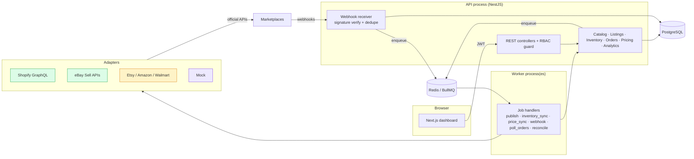

# Architecture



## Core ideas

**One central record, many channel views.** Every marketplace listing (`listings` + `listing_variants`) points to a central `products`/`variants` row. What a channel shows is computed by `ListingsService.effective()`: the master product, with any channel override (`listings.overrides`) taking precedence. Editing the master never overwrites a customised channel field. "Re-sync from master" explicitly deletes chosen overrides.

**Adapters isolate marketplace differences.** The core never calls a marketplace directly. Each adapter declares `capabilities` (auth type, webhook support, whether labels/tracking are possible, how "pause" works, approval requirements) and the UI reads those to decide what to offer.

## Inventory model and oversell protection

```
available        = Σ on_hand − Σ reserved          (across warehouses)
channel quantity = max(0, available − safety buffer)   ← pushed to every listing
bundle available = min(component available ÷ qty per bundle)
```

1. **Atomic reservation.** `InventoryService.reserve()` is a single conditional `UPDATE … WHERE on_hand − reserved >= qty` inside the order's transaction. Postgres row locks serialise concurrent orders on a SKU. The second order re-evaluates the condition after the first commits, so the last unit can only be taken once. DB `CHECK (reserved <= on_hand)` and `CHECK (on_hand >= 0)` are a second line of defence. Tested with 10 parallel orders for 1 unit.
2. **Order de-duplication.** `UNIQUE (connection_id, external_order_id)` plus `INSERT … ON CONFLICT DO NOTHING`. The same order arriving by webhook *and* poll is deducted once. Webhooks are separately de-duplicated on the marketplace event id.
3. **Exact allocations.** `order_item_allocations` records which variant × warehouse each line holds (bundles hold their components), so cancel/fulfil releases or consumes exactly that.
4. **Idempotent fan-out.** After every committed change, `inventory_sync` pushes an *absolute* quantity to every published listing of the affected SKUs (and bundles that contain them). Retries and duplicate jobs are harmless. Each connection is isolated: one failing marketplace is logged, notified and retried without blocking the others.
5. **Reconciliation.** An hourly job force-pushes every listing's quantity, correcting drift from failed pushes or missed events.
6. **Safety buffer.** Org-wide (units or %) or per SKU. It absorbs the seconds-to-minutes before marketplaces apply an update.

**Honest limit:** no system can stop a marketplace from selling a unit in the window *before* it has received our zero. If that happens, the line is marked `short`, the order is flagged `stock_conflict`, a notification is raised, and stock never goes negative. The buffer is the tool for shrinking that window.

Order lifecycle → stock:

| Event | Effect |
|---|---|
| New order (paid) | reserve (available ↓, on hand unchanged) |
| Cancelled | release reservation (available ↑) |
| Fulfilled / tracking added | consume (on hand ↓, reserved ↓) |
| Manual adjustment | on hand ± (can't go below reserved) |

## Background jobs

BullMQ queue `omnichannel` with 5 attempts and exponential backoff. Marketplace HTTP calls also retry 429/5xx honouring `Retry-After` (`marketplaces/http.ts`). Repeatable jobs: `poll_orders` per live connection (default every 10 min; the primary path for eBay) and `reconcile` (default hourly). Workers scale horizontally. `JOBS_INLINE=true` runs handlers in-process for tests.

## Security

- Passwords: bcrypt (cost 12). Sessions: signed JWT (12 h).
- RBAC: `owner > admin > manager > viewer`. Reads are viewer+, catalog/stock/order writes manager+, connections/settings/users admin+.
- Multi-tenant: every query is scoped by `org_id` (tested).
- Marketplace credentials: AES-256-GCM (`common/crypto.ts`), key from `ENCRYPTION_KEY`. Never returned by any endpoint (tested). Disconnect deletes them. In production, supply the key from a secret manager.
- OAuth: random `state` stored server-side (15 min expiry), PKCE for Etsy, Shopify callback HMAC verified.
- Webhooks: verified against the raw request body (Shopify HMAC-SHA256, Etsy Standard Webhooks with 5-minute replay window, eBay ECDSA via public key, mock HMAC). Unverified requests get 401.
- `helmet` headers, CORS restricted to `WEB_ORIGIN`, request size limits, Zod validation on every write.

## Data, backups and recovery

- Forward-only SQL migrations, each applied in a transaction (`scripts/migrate.ts`).
- `ops/backup.sh`: nightly gzip `pg_dump` with 14-day retention. In production also enable managed point-in-time recovery.
- Redis runs with AOF persistence in compose so queued jobs survive restarts. Even if Redis is lost, the reconciliation job restores correct stock on every channel.
- The activity log, inventory movements, price history and sync logs give a full audit trail.

## Multi-warehouse

Already modelled: `inventory_levels` is per variant × warehouse, and reservations pick the default warehouse first, then any warehouse that can cover the whole line. Still to build (future phase): per-channel warehouse assignment and split shipments.
